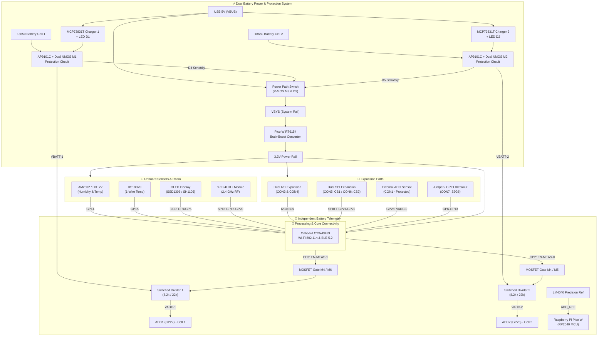
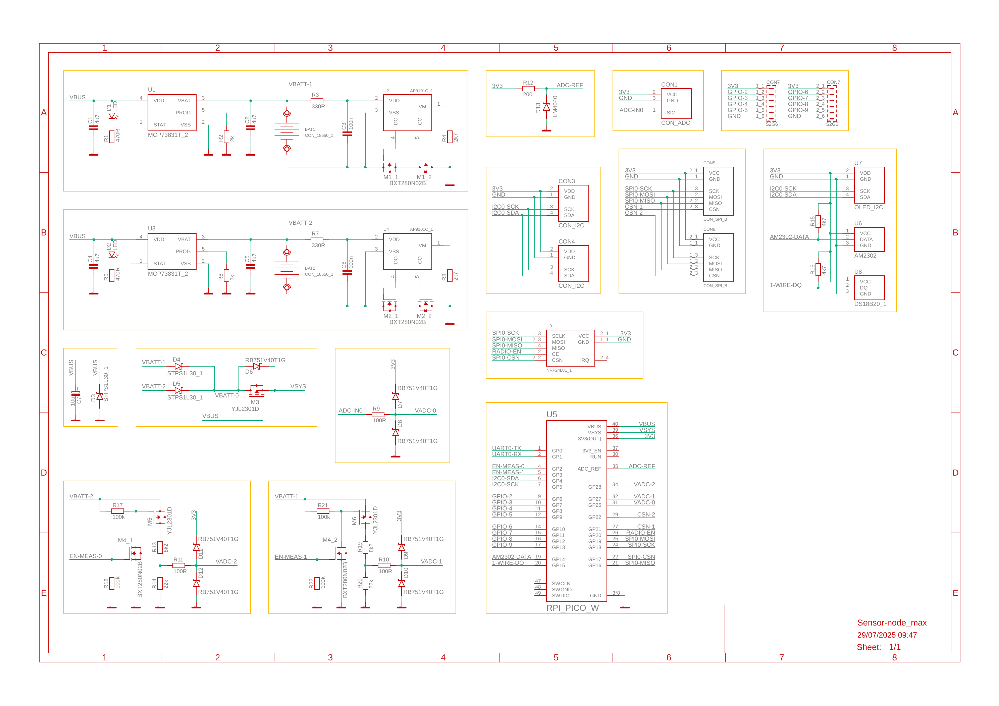

# IoT Sensor Node Max (`iot-sensor-node-max`)

> Full-featured wireless IoT environmental & telemetry node based on the Raspberry Pi Pico W, equipped with dual 18650 Li-Ion batteries, independent dual-channel charging & protection, zero-quiescent voltage sensing, multiple sensor interfaces, rich expansion ports (dual I2C, dual SPI, analog ADC), and complete production-ready CAM Gerber data.

**Project Status:** Completed & Functional | **Technologies:** Autodesk Eagle, Hardware PCB Design, RP2040 / Pico W, RS-274X Gerbers, MicroPython / C++

---

## 1. Overview & Key Features

The **IoT Sensor Node Max** is the high-capacity, expandable flagship hardware revision in the Raspberry Pi Pico W sensor node family. Designed for remote deployments where long battery autonomy and extensive sensor connectivity are vital, it doubles the battery capacity with two 18650 cells, provides independent per-cell safety and charging circuits, and breaks out dual I2C, dual SPI, analog ADC, and multi-purpose GPIO expansion headers.

### Key Highlights
- **Microcontroller:** Raspberry Pi Pico W socket (RP2040 dual-core ARM Cortex-M0+ up to 133 MHz, 264 KB SRAM, 2 MB Flash, onboard 2.4 GHz 802.11n Wi-Fi and BLE 5.2).
- **Dual-Cell Power Architecture:**
  - Dual 18650 Li-Ion battery holders (`BAT1` & `BAT2`) with parallel power path configuration for doubled battery operating life.
  - **Dual Microchip MCP73831T** linear Li-Ion charge controllers (`U1`, `U3`) with independent charging status LEDs (`D1`, `D2`), charging both cells in parallel via USB VBUS.
  - **Dual Diodes Inc. AP9101C** dedicated protection ICs (`U2`, `U4`) paired with dual **BXT280N02B** N-MOSFETs (`M1`, `M2`) providing independent overcharge, overdischarge cutoff, and short-circuit protection for each individual cell.
  - **Triple Power Path Switch:** Schottky diode array (`STPS1L30`) and P-channel power MOSFET (`YJL2301D`, `M3`) for seamless automatic handover between external USB 5 V and battery rails.
- **Dual-Channel Precision Battery Monitoring:**
  - **LM4040** precision shunt voltage reference tied to RP2040 `ADC_REF`.
  - Independent switched resistor dividers for each battery cell:
    - Cell 1: Switched by GP3 (`EN-MEAS-1`) via MOSFETs `M4` & `M6` into `VADC-1` (`GP27`).
    - Cell 2: Switched by GP2 (`EN-MEAS-0`) via MOSFETs `M4` & `M5` into `VADC-2` (`GP28`).
  - Zero quiescent current draw through measurement dividers during sleep mode.
  - Diode clamping protection (`RB751V40T1G`) across all ADC inputs.
- **Integrated Sensors & Displays:**
  - **AM2302 (DHT22):** Relative humidity and ambient temperature digital sensor on `GP14`.
  - **DS18B20:** 1-Wire precision digital temperature sensor on `GP15`.
  - **OLED Display Header:** 4-pin socket for 0.96" or 1.3" I2C OLED displays (SSD1306 / SH1106) on `I2C0` (`GP4` / `GP5`).
  - **nRF24L01+ 2.4 GHz RF Header:** SPI socket for Nordic nRF24L01+ wireless transceiver module on `SPI0` (`GP16`–`GP20`).
- **Rich Expansion Connectors:**
  - **Dual I2C Connectors (`CON3`, `CON4`):** 4-pin headers for external I2C sensor daisy chains (BME280, SHT31, INA219, etc.).
  - **Dual SPI Connectors (`CON5`, `CON6`):** 5-pin headers with dedicated independent Chip Selects `CSN-1` (`GP21`) and `CSN-2` (`GP22`).
  - **External Analog Input (`CON1`):** 3-pin connector (VCC, GND, SIG) on `GP26` with Schottky overvoltage clamping for analog sensors.
  - **S2G6 Jumper / Breakout (`CON7`):** Multi-purpose configuration jumper matrix breaking out digital GPIOs `GP6`–`GP13`.
- **Complete Manufacturing Package:** Includes verified RS-274X Gerbers, NC drill files, automated Pick & Place (PnP) centroid files, and pre-packaged ZIP archives ready for PCB manufacturing (JLCPCB, PCBWay).

---

## 2. Architecture & Block Diagram



---

## 3. Schematic & Circuit Diagram



📄 [Open original high-resolution schematic (PDF)](Sensor-node_max.pdf)

---

## 4. Hardware Specifications & Pin Mapping

### Complete Pico W Pinout

| Pico W Pin | Eagle Net Name | Hardware Function / Connected Device | Notes |
| :--- | :--- | :--- | :--- |
| **GP0** | `UART0-TX` | Serial UART TX | Debug / serial telemetry |
| **GP1** | `UART0-RX` | Serial UART RX | Debug / serial telemetry |
| **GP2** | `EN-MEAS-0` | Battery 2 measurement enable | Gates M4 & M5 MOSFETs |
| **GP3** | `EN-MEAS-1` | Battery 1 measurement enable | Gates M4 & M6 MOSFETs |
| **GP4** | `I2C0-SDA` | I2C Data bus | Connected to OLED, CON3, CON4 (pull-up R15) |
| **GP5** | `I2C0-SCK` | I2C Clock bus | Connected to OLED, CON3, CON4 (pull-up R16) |
| **GP6–GP9** | `GPIO-2`..`GPIO-5`| Digital GPIO pins | Broken out on CON7 jumper block |
| **GP10–GP13**| `GPIO-6`..`GPIO-9`| Digital GPIO pins | Broken out on CON7 jumper block |
| **GP14** | `AM2302-DATA` | AM2302 / DHT22 Data | Onboard relative humidity / temperature |
| **GP15** | `1-WIRE-DQ` | DS18B20 1-Wire Data | Onboard digital temperature probe |
| **GP16** | `SPI0-MISO` | SPI0 MISO | nRF24L01+ socket & CON5, CON6 expansion |
| **GP17** | `SPI0-CSN` | nRF24L01+ Chip Select | Dedicated SPI0 CSN for RF module |
| **GP18** | `SPI0-SCK` | SPI0 Clock | nRF24L01+ socket & CON5, CON6 expansion |
| **GP19** | `SPI0-MOSI` | SPI0 MOSI | nRF24L01+ socket & CON5, CON6 expansion |
| **GP20** | `RADIO-EN` | nRF24L01+ Chip Enable (CE) | Radio TX/RX enable |
| **GP21** | `CSN-1` | Expansion SPI 1 Chip Select | Dedicated CS for CON5 expansion header |
| **GP22** | `CSN-2` | Expansion SPI 2 Chip Select | Dedicated CS for CON6 expansion header |
| **GP26** | `VADC-0` | Analog ADC Channel 0 | External analog input (CON1), diode protected |
| **GP27** | `VADC-1` | Analog ADC Channel 1 | Switched battery 1 voltage measurement |
| **GP28** | `VADC-2` | Analog ADC Channel 2 | Switched battery 2 voltage measurement |
| **ADC_REF** | `ADC-REF` | Reference Voltage | Tied to LM4040 precision shunt reference |

### Expansion Connectors Pinout

- **`CON1` (External ADC):** Pin 1 = `3V3`, Pin 2 = `VADC-0` (analog in with Schottky protection), Pin 3 = `GND`.
- **`CON3` & `CON4` (Dual I2C):** Pin 1 = `3V3`, Pin 2 = `GND`, Pin 3 = `I2C0-SCK`, Pin 4 = `I2C0-SDA`.
- **`CON5` (SPI Expansion 1):** Pin 1 = `3V3`, Pin 2 = `GND`, Pin 3 = `SPI0-SCK`, Pin 4 = `SPI0-MOSI`, Pin 5 = `SPI0-MISO`, Pin 6 = `CSN-1` (`GP21`).
- **`CON6` (SPI Expansion 2):** Pin 1 = `3V3`, Pin 2 = `GND`, Pin 3 = `SPI0-SCK`, Pin 4 = `SPI0-MOSI`, Pin 5 = `SPI0-MISO`, Pin 6 = `CSN-2` (`GP22`).
- **`CON7` (S2G6 Jumper):** Configurable jumper links for matrix routing between GP6–GP9 and GP10–GP13.

---

## 5. PCB Layout & Manufacturing Specifications

- **PCB Dimensions:** 78.79 mm × 54.56 mm (3.10" × 2.15")
- **Layer Count:** 2 layers (Top Copper, Bottom Copper)
- **Minimum Trace / Clearance:** 0.25 mm / 0.25 mm (10 mil / 10 mil)
- **Board Outline:** Chamfered corners with mounting holes for standardized enclosures.
- **Top Side:** Raspberry Pi Pico W module, OLED display header, nRF24L01+ socket, sensor headers, expansion ports (CON1–CON7).
- **Bottom Side:** Dual 18650 battery spring clips (`BAT1`, `BAT2`), dual chargers, and protection ICs.

### Manufacturing Files (`CAMOutputs/`)

| Directory / File | Format | Description |
| :--- | :--- | :--- |
| `CAMOutputs/GerberFiles/copper_top.gbr` | RS-274X | Layer 1 Top Copper |
| `CAMOutputs/GerberFiles/copper_bottom.gbr`| RS-274X | Layer 16 Bottom Copper |
| `CAMOutputs/GerberFiles/soldermask_top.gbr` | RS-274X | Top Soldermask |
| `CAMOutputs/GerberFiles/soldermask_bottom.gbr`| RS-274X | Bottom Soldermask |
| `CAMOutputs/GerberFiles/silkscreen_top.gbr` | RS-274X | Top Silkscreen Legend |
| `CAMOutputs/GerberFiles/silkscreen_bottom.gbr`| RS-274X | Bottom Silkscreen Legend |
| `CAMOutputs/GerberFiles/profile.gbr` | RS-274X | Board Edge Outline / Milling |
| `CAMOutputs/DrillFiles/drill_1_16.xln` | Excellon NC | Plated and Non-Plated Through Holes |
| `CAMOutputs/Assembly/PnP_Sensor-node_max_*.txt` | Text Centroid | Pick & Place automated component positions |
| `Sensor-node_max_2025-07-29.zip` | ZIP Archive | Complete ready-to-order Gerber package |

---

## 6. Repository Structure

```text
.
├── docs/
│   └── images/
│       └── schematic.png   # High-resolution schematic preview (180 DPI)
├── CAMOutputs/
│   ├── Assembly/           # Automated Pick & Place and BOM files
│   ├── DrillFiles/         # Excellon NC drill files
│   └── GerberFiles/        # RS-274X fabrication photoplot files
├── Sensor-node_max.sch     # Autodesk Eagle schematic
├── Sensor-node_max.brd     # Autodesk Eagle PCB layout
├── Sensor-node_max.pdf     # High-resolution schematic and layout drawing export
├── Sensor-node_max.cam     # CAM processor job file
├── Sensor-node_max.dru     # Design rules specification (DRC)
├── Sensor-node_max.scr     # Eagle layer script
├── Sensor-node_max_*.zip   # Pre-packaged Gerber archives for manufacturing
├── .gitignore              # Eagle & OS backup filter
└── README.md               # Project documentation
```

---

## 7. How to Use & Firmware Deployment

### MicroPython Dual-Battery Reading Example

The following snippet demonstrates reading both independent battery voltages while ensuring zero power waste during deep sleep:

```python
from machine import Pin, ADC
import time

en_meas_1 = Pin(3, Pin.OUT)  # Cell 1 measurement gate
en_meas_0 = Pin(2, Pin.OUT)  # Cell 2 measurement gate
adc_1 = ADC(Pin(27))         # Cell 1 ADC (GP27)
adc_2 = ADC(Pin(28))         # Cell 2 ADC (GP28)

def read_battery_voltages():
    # Measure Cell 1
    en_meas_1.value(1)
    time.sleep_us(50)
    raw1 = adc_1.read_u16()
    en_meas_1.value(0)

    # Measure Cell 2
    en_meas_0.value(1)
    time.sleep_us(50)
    raw2 = adc_2.read_u16()
    en_meas_0.value(0)

    # Convert using 8.2k / 22k divider ratio and 3.3V reference
    ratio = (8.2 + 22.0) / 22.0
    v1 = (raw1 / 65535.0) * 3.3 * ratio
    v2 = (raw2 / 65535.0) * 3.3 * ratio
    return v1, v2

v_cell1, v_cell2 = read_battery_voltages()
print(f"Battery 1: {v_cell1:.2f} V | Battery 2: {v_cell2:.2f} V")
```

---

## 8. Relations & Ecosystem Links

This project is part of a modular IoT sensor ecosystem:
- **[`iot-sensor-node-med`](https://github.com/nagyjose/iot-sensor-node-med):** Compact single-cell sibling node for constrained enclosures.
- **[`pico-w-iot-nodes`](https://github.com/nagyjose/pico-w-iot-nodes):** MicroPython firmware repository providing BLE GATT service, MQTT telemetry, sensor reading drivers, and power management loops.
- **[`ble-sensor-gui`](https://github.com/nagyjose/ble-sensor-gui):** PyQt5 / QML cross-platform telemetry monitoring dashboard.

---

## 9. License & Author

- **Author:** Josef Nagy (`nagyjose`)
- **Design Tool:** Autodesk Eagle v9.x
- **License:** Open Hardware / MIT License
